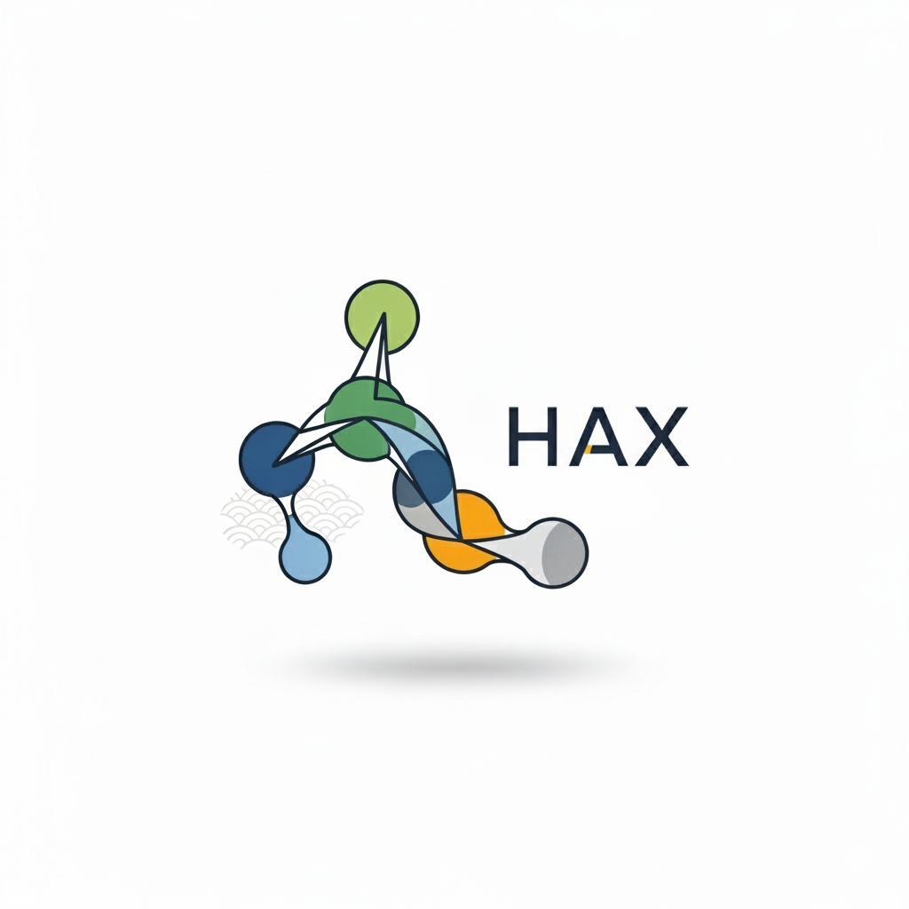

---
hide:
  - navigation
  - toc
---

<div class="hax-hero" markdown>

{ .hax-logo }

# Hax — Heterogeneity Analysis for CryoEM

<p class="hax-tagline">
A suite of GPU-accelerated tools to study <strong>conformational heterogeneity</strong>
in Cryo-EM data. Estimate the continuous motions of your macromolecules, build and merge
conformational landscapes, and reconstruct motion-corrected volumes — all from a single
command line.
</p>

<div class="hax-buttons" markdown>
[:material-rocket-launch: Get Started](getting-started/installation.md){ .md-button .md-button--primary }
[:material-apps: Browse Programs](programs/index.md){ .md-button }
[:material-source-branch: View Workflows](workflows/pipelines.md){ .md-button }
</div>

<p class="hax-badges" markdown>


</p>

</div>

<!--
  Want an even more eye-catching landing page? Drop a short screen-recording of the
  Annotate Space viewer here, e.g.:
  { .hax-demo }
  (a ~5-10 s GIF/WebP under ~3 MB works best). The animated SVG below is a self-contained
  placeholder that needs no external file.
-->

<figure class="hax-showcase" markdown="0">
<svg viewBox="0 0 820 360" role="img" xmlns="http://www.w3.org/2000/svg" aria-label="Illustration of a conformational landscape: a cloud of points representing particle conformations with a trajectory tracing a continuous motion.">
  <defs>
    <linearGradient id="haxBg" x1="0" y1="0" x2="1" y2="1">
      <stop offset="0" stop-color="#1e1b4b"/>
      <stop offset="1" stop-color="#3730a3"/>
    </linearGradient>
    <radialGradient id="haxGlow" cx="42%" cy="38%" r="62%">
      <stop offset="0" stop-color="#a855f7" stop-opacity="0.45"/>
      <stop offset="1" stop-color="#a855f7" stop-opacity="0"/>
    </radialGradient>
    <linearGradient id="haxTraj" x1="0" y1="0" x2="1" y2="0">
      <stop offset="0" stop-color="#6366f1"/>
      <stop offset="0.5" stop-color="#a855f7"/>
      <stop offset="1" stop-color="#ec4899"/>
    </linearGradient>
    <filter id="haxSoft" x="-50%" y="-50%" width="200%" height="200%">
      <feGaussianBlur stdDeviation="2.2"/>
    </filter>
  </defs>

  <rect width="820" height="360" rx="18" fill="url(#haxBg)"/>
  <rect width="820" height="360" rx="18" fill="url(#haxGlow)"/>

  <!-- conformational landscape: cloud of particle points -->
  <g fill="url(#haxTraj)">
    <circle cx="180" cy="120" r="6"><animate attributeName="opacity" values="0.35;1;0.35" dur="3.2s" repeatCount="indefinite" begin="0s"/></circle>
    <circle cx="240" cy="90" r="5"><animate attributeName="opacity" values="0.35;1;0.35" dur="3.6s" repeatCount="indefinite" begin="0.4s"/></circle>
    <circle cx="300" cy="140" r="7"><animate attributeName="opacity" values="0.35;1;0.35" dur="3.0s" repeatCount="indefinite" begin="0.8s"/></circle>
    <circle cx="210" cy="180" r="5"><animate attributeName="opacity" values="0.35;1;0.35" dur="3.8s" repeatCount="indefinite" begin="1.1s"/></circle>
    <circle cx="280" cy="210" r="6"><animate attributeName="opacity" values="0.35;1;0.35" dur="3.4s" repeatCount="indefinite" begin="0.2s"/></circle>
    <circle cx="350" cy="100" r="5"><animate attributeName="opacity" values="0.35;1;0.35" dur="3.1s" repeatCount="indefinite" begin="1.4s"/></circle>
    <circle cx="360" cy="190" r="8"><animate attributeName="opacity" values="0.35;1;0.35" dur="3.7s" repeatCount="indefinite" begin="0.6s"/></circle>
    <circle cx="420" cy="150" r="6"><animate attributeName="opacity" values="0.35;1;0.35" dur="3.3s" repeatCount="indefinite" begin="1.0s"/></circle>
    <circle cx="430" cy="230" r="5"><animate attributeName="opacity" values="0.35;1;0.35" dur="3.5s" repeatCount="indefinite" begin="0.3s"/></circle>
    <circle cx="480" cy="120" r="7"><animate attributeName="opacity" values="0.35;1;0.35" dur="3.0s" repeatCount="indefinite" begin="1.6s"/></circle>
    <circle cx="500" cy="200" r="6"><animate attributeName="opacity" values="0.35;1;0.35" dur="3.9s" repeatCount="indefinite" begin="0.9s"/></circle>
    <circle cx="540" cy="260" r="5"><animate attributeName="opacity" values="0.35;1;0.35" dur="3.2s" repeatCount="indefinite" begin="1.2s"/></circle>
    <circle cx="560" cy="160" r="8"><animate attributeName="opacity" values="0.35;1;0.35" dur="3.6s" repeatCount="indefinite" begin="0.5s"/></circle>
    <circle cx="610" cy="220" r="6"><animate attributeName="opacity" values="0.35;1;0.35" dur="3.4s" repeatCount="indefinite" begin="1.5s"/></circle>
    <circle cx="630" cy="130" r="5"><animate attributeName="opacity" values="0.35;1;0.35" dur="3.1s" repeatCount="indefinite" begin="0.7s"/></circle>
    <circle cx="330" cy="250" r="5"><animate attributeName="opacity" values="0.35;1;0.35" dur="3.7s" repeatCount="indefinite" begin="0.1s"/></circle>
    <circle cx="250" cy="260" r="6"><animate attributeName="opacity" values="0.35;1;0.35" dur="3.3s" repeatCount="indefinite" begin="1.3s"/></circle>
    <circle cx="460" cy="280" r="5"><animate attributeName="opacity" values="0.35;1;0.35" dur="3.5s" repeatCount="indefinite" begin="0.45s"/></circle>
    <circle cx="150" cy="220" r="5"><animate attributeName="opacity" values="0.35;1;0.35" dur="3.8s" repeatCount="indefinite" begin="1.05s"/></circle>
    <circle cx="670" cy="180" r="6"><animate attributeName="opacity" values="0.35;1;0.35" dur="3.0s" repeatCount="indefinite" begin="0.85s"/></circle>
  </g>

  <!-- continuous-motion trajectory through the landscape -->
  <path id="haxPath" d="M180,120 C300,60 360,260 460,200 S640,120 670,180"
        fill="none" stroke="url(#haxTraj)" stroke-width="3" stroke-linecap="round"
        stroke-dasharray="6 10" opacity="0.85">
    <animate attributeName="stroke-dashoffset" values="160;0" dur="6s" repeatCount="indefinite"/>
  </path>

  <!-- gliding marker (a "conformation" moving along the motion) -->
  <circle r="9" fill="#ffffff" filter="url(#haxSoft)">
    <animateMotion dur="6s" repeatCount="indefinite" rotate="auto"
      path="M180,120 C300,60 360,260 460,200 S640,120 670,180"/>
  </circle>
  <circle r="5" fill="#ec4899">
    <animateMotion dur="6s" repeatCount="indefinite" rotate="auto"
      path="M180,120 C300,60 360,260 460,200 S640,120 670,180"/>
  </circle>

  <text x="40" y="320" fill="#c7d2fe" font-family="Inter, sans-serif" font-size="15" font-weight="600">A conformational landscape</text>
  <text x="40" y="342" fill="#a5b4fc" font-family="Inter, sans-serif" font-size="12.5">each point is a particle &middot; the path traces a continuous motion</text>
</svg>
<figcaption>From thousands of single-particle snapshots to a navigable map of motion.</figcaption>
</figure>

---

## What is Hax?

When a protein or molecular machine is imaged with Cryo-EM, every particle is a snapshot
of the molecule frozen in a slightly different **shape** (or *conformation*). Classical
reconstruction averages these snapshots into a single rigid map — and in doing so, it
*blurs away* the very motions that make the molecule biologically interesting.

**Hax** is a collection of tools designed to recover that lost information. It uses modern
neural networks (built on **JAX + Flax**) to learn how your molecule moves, to place every
particle on a map of conformations (a *conformational landscape*), and to turn that
landscape back into 3D structures you can inspect.

You do not need to be a machine-learning expert to use Hax. Every tool is a single
command, the defaults are sensible, and this documentation explains each option in plain
language.

!!! tip "New to conformational heterogeneity?"
    Start with the [Core Concepts](getting-started/concepts.md) page. It introduces the
    handful of ideas — latent spaces, the CTF, metadata files, training modes — that show
    up across every Hax program.

---

## What can it do?

<div class="grid cards" markdown>

-   :material-cube-scan:{ .lg .middle } &nbsp; __Analyze motions__

    ---

    Recover continuous conformational changes with **HetSIREN**, **Zernike3Deep**
    and **ReconSIREN**.

    [:octicons-arrow-right-24: Heterogeneity analysis](programs/index.md#heterogeneity-analysis)

-   :material-vector-combine:{ .lg .middle } &nbsp; __Merge landscapes__

    ---

    Reconcile results from several methods into a single consensus space with
    **FlexConsensus**.

    [:octicons-arrow-right-24: FlexConsensus](programs/flexconsensus.md)

-   :material-chart-scatter-plot:{ .lg .middle } &nbsp; __Explore interactively__

    ---

    Navigate your landscape and generate volumes in real time with the
    **Annotate Space** viewer.

    [:octicons-arrow-right-24: Annotate Space](programs/annotate_space.md)

-   :material-blur:{ .lg .middle } &nbsp; __Reconstruct without blur__

    ---

    Build motion-corrected volumes that remove the smearing caused by flexibility,
    with **MoDART**.

    [:octicons-arrow-right-24: MoDART](programs/modart.md)

</div>

---

## Install in one line

=== "CUDA 12"

    ```bash
    pip install hax-em[cuda12]
    ```

=== "CUDA 13"

    ```bash
    pip install hax-em[cuda13]
    ```

CUDA itself is installed for you — you only need a recent NVIDIA driver (≥ 525). See the
full [installation guide](getting-started/installation.md) for the recommended Conda setup.

---

## A typical session

```bash
# 1. See what is available
hax_project_manager -h

# 2. Learn the conformational landscape of your particles
hax_project_manager --gpu 0 zernike3deep \
    --md particles.xmd --vol reference.mrc --sr 1.5 \
    --ctf_type apply --mode train --output_path results/

# 3. Explore the landscape interactively
hax_project_manager annotate_space \
    --z_space results/predicted_latents.xmd --path annotation/
```

Ready to dive in? Head to [Getting Started](getting-started/installation.md), or jump
straight to the [Programs overview](programs/index.md).

---

## How to cite Hax

If Hax is useful in your research, please cite the relevant method(s). The full reference
list — Zernike3D, HetSIREN, ZART/MoDART and FlexConsensus — is on the
[Contact & Support](support/contact.md#references) page.
