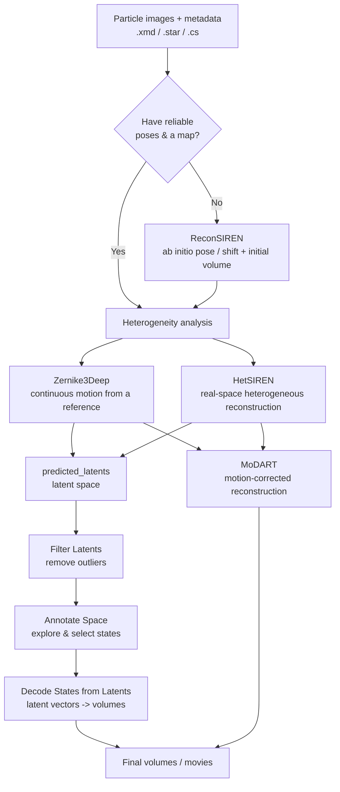
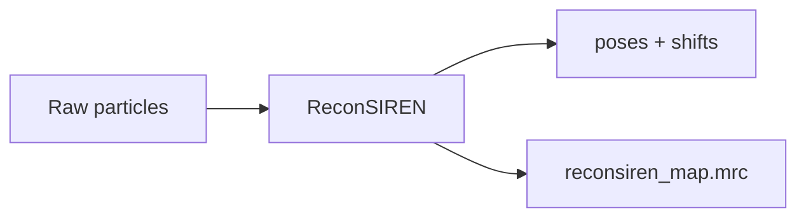
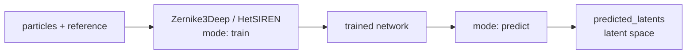
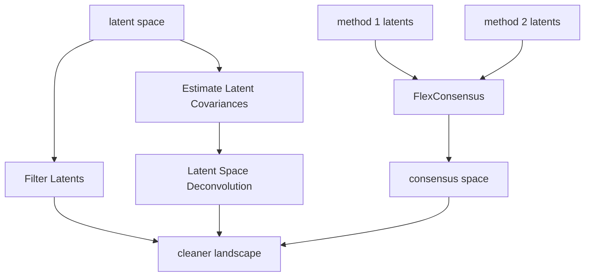
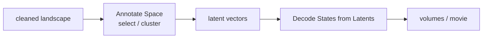
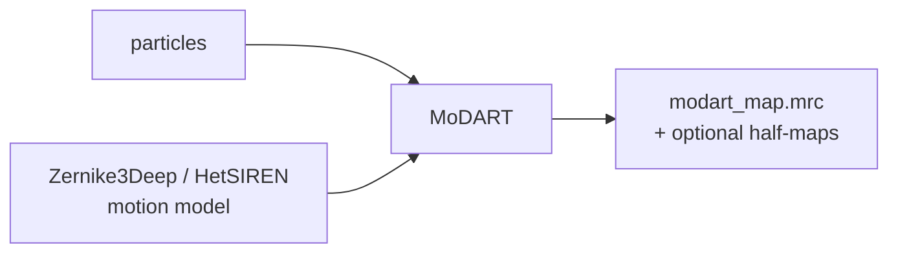

# Pipelines

Hax programs are designed to be **chained**. The output of one is the input of the next: a
metadata file becomes a landscape, a landscape becomes states, states become motion-corrected
maps. This page shows how the pieces fit together so you can plan a project end to end.

!!! tip "Read this alongside the [Programs overview](../programs/index.md)"
    Each box below links to the program that performs it. For runnable, copy-paste sequences
    see [Real-Case Examples](examples.md).

---

## The big picture

---

## Stage 1 — Get a starting point

Before studying *motion*, you need decent **poses** (orientations + shifts) and, ideally, a
**consensus map**.

- If your particles already have a good alignment from an upstream package (Relion, Xmipp,
  cryoSPARC…), you can go straight to Stage 2.
- If not, or to refine what you have, use **[ReconSIREN](../programs/reconsiren.md)** for an
  ab initio assignment and an initial volume.

---

## Stage 2 — Estimate the conformational landscape

This is the heart of Hax. Pick the method that matches your situation:

| Choose… | When |
|---------|------|
| **[Zernike3Deep](../programs/zernike3deep.md)** | You have a good reference volume and want smooth, interpretable deformations (and want to feed [MoDART](../programs/modart.md) later). |
| **[HetSIREN](../programs/hetsiren.md)** | You want flexible, high-fidelity real-space heterogeneous reconstruction, with optional mass transport / local refinement. |

Both produce, after a `predict` run, a **latent space** describing every particle's
conformation (`predicted_latents.xmd`/`.star`, and a `.npy` of the latent vectors).

---

## Stage 3 — Clean, merge and sharpen the landscape

Optional refinements that make the landscape more trustworthy:

- **[Filter Latents](../programs/filter_latents.md)** — drop outlier particles.
- **[FlexConsensus](../programs/flexconsensus.md)** — merge landscapes from *several* methods
  into one consensus space (and check what is reproducible).
- **[Estimate Latent Covariances](../programs/estimate_latent_covariances.md)** →
  **[Latent Space Deconvolution](../programs/latent_space_deconvolution.md)** — remove the
  estimation blur so distinct states separate cleanly.

---

## Stage 4 — Explore and materialize states

- **[Annotate Space](../programs/annotate_space.md)** — explore the landscape interactively,
  cluster it, and select the conformations you care about.
- **[Decode States from Latents](../programs/decode_states_from_latents.md)** — turn the
  selected latent vectors (cluster centres, a trajectory, …) into 3D volumes.

---

## Stage 5 — Motion-corrected reconstruction

To obtain a **sharp** map that is not blurred by flexibility, feed a motion model
(Zernike3Deep, or HetSIREN trained with transport of mass) into
**[MoDART](../programs/modart.md)**.

---

## Supporting steps you can drop in anywhere

- **[Display Metrics](../programs/display_metrics.md)** — monitor any training run's curves.
- **[Image](../programs/image_gray_scale_adjustment.md) / [Volume](../programs/volume_gray_scale_adjustment.md)
  Gray-Scale Adjustment** — match intensity levels when comparing or combining maps and
  images.

Ready for concrete commands? Continue to [Real-Case Examples](examples.md).
