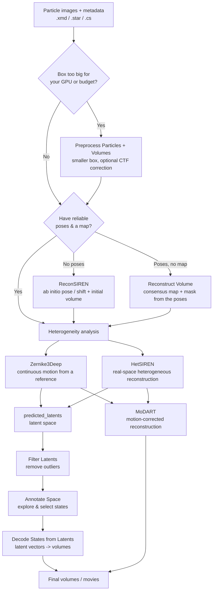
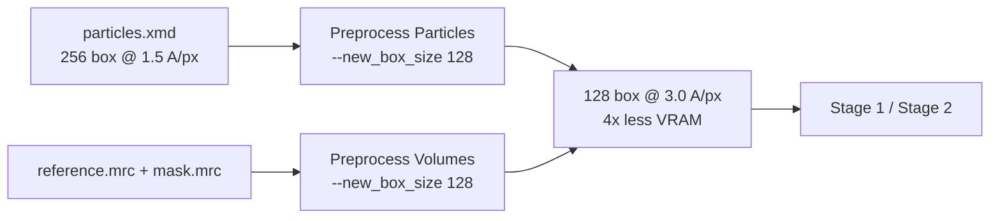
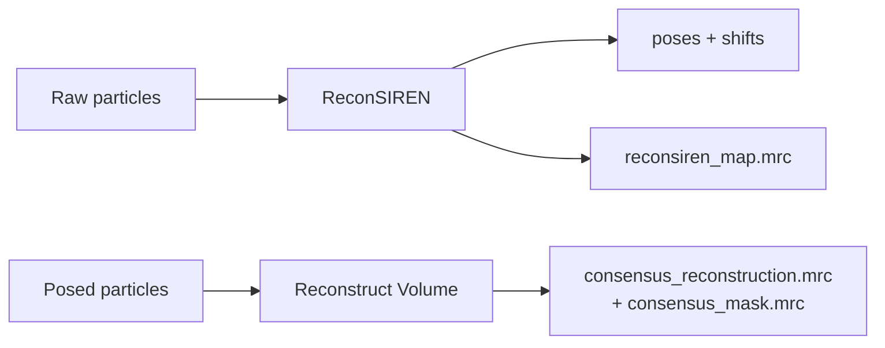
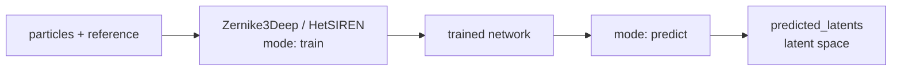
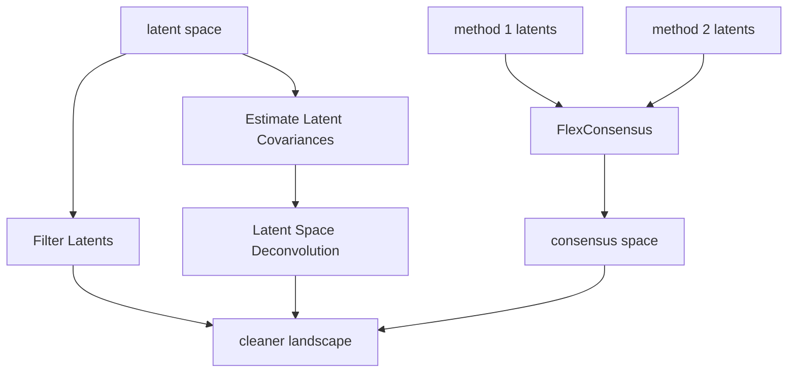
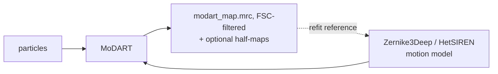

# Pipelines

Hax programs are designed to be **chained**. The output of one is the input of the next: a
metadata file becomes a landscape, a landscape becomes states, states become motion-corrected
maps. This page shows how the pieces fit together so you can plan a project end to end.

!!! tip "Read this alongside the [Programs overview](../programs/index.md)"
    Each box below links to the program that performs it. For runnable, copy-paste sequences
    see [Real-Case Examples](examples.md).

---

## The big picture

---

## Stage 0 — Preprocess (optional, but often worth it)

Everything downstream reads the same particles over and over. Shrinking them **once** is the
cheapest lever you have on VRAM and wall-clock time — and the one that costs you resolution, so
spend it deliberately.

- **[Preprocess Particles](../programs/preprocess_particles.md)** — crop and/or downsample the
  stack, and optionally correct the CTF (Wiener or phase flip) once instead of every epoch.
- **[Preprocess Volumes](../programs/preprocess_volumes.md)** — put the reference map and its mask
  on the *same* box and sampling rate.

Halving the box divides the pixel count — and roughly the memory a network needs — by **four**,
while training gets correspondingly faster. What you give up is resolution: the new Nyquist
frequency becomes `2 × sr × box_in / box_out` Å, and **no downstream program can recover detail
beyond it**. A common, honest strategy is to explore on a small box and, once the landscape and
the parameters are settled, repeat the final run at full size.

!!! warning "Three things to carry forward"
    - **Pass the new `--sr`** (printed by the program) to every downstream run.
    - If you used `--ctf_correction`, run downstream programs with **`--ctf_type None`** — the
      images are already corrected, and doing it twice corrupts the analysis.
    - Preprocess the **volume and the mask with the same settings** as the particles, or the
      projections will not line up with the images.

!!! tip "If preprocessing itself runs out of memory"
    Preprocessing a large box is the one step that can OOM *before* you have shrunk anything. Pass
    **`--batch_size auto`** to
    [Preprocess Particles](../programs/preprocess_particles.md#-batch_size-auto) and it will size
    the batch to your card analytically. It exists to make a big box fit, not to go faster.

---

## Stage 1 — Get a starting point

Before studying *motion*, you need decent **poses** (orientations + shifts) and, ideally, a
**consensus map**.

- If your particles already have a good alignment from an upstream package (Relion, Xmipp,
  cryoSPARC…) **and** a reference map, you can go straight to Stage 2.
- If they have good poses but **no map** (or one you do not trust), build one with
  **[Reconstruct Volume](../programs/reconstruct_volume.md)**: the poses alone are enough to
  recover a consensus map in a single pass, together with the mask derived from it. It reports
  the resolution it reached (half-map FSC), so you know what you are handing to Stage 2.
- If the poses themselves are missing or unreliable, use
  **[ReconSIREN](../programs/reconsiren.md)** for an ab initio assignment and an initial volume.

!!! tip "HetSIREN will do it for you"
    Launched with neither `--vol` nor `--mask`, [HetSIREN](../programs/hetsiren.md) runs this
    same reconstruction internally. Doing it as an explicit step is worth it when you want to
    inspect the reference first, tune the mask, or reuse one reference across several runs.

---

## Stage 2 — Estimate the conformational landscape

This is the heart of Hax. Pick the method that matches your situation:

| Choose… | When |
|---------|------|
| **[Zernike3Deep](../programs/zernike3deep.md)** | You have a good reference volume and want smooth, interpretable deformations (and want to feed [MoDART](../programs/modart.md) later). |
| **[HetSIREN](../programs/hetsiren.md)** | You want flexible, high-fidelity real-space heterogeneous reconstruction, with optional mass transport / local refinement. |

Both produce, after a `predict` run, a **latent space** describing every particle's
conformation (`predicted_latents.xmd`/`.star`, and a `.npy` of the latent vectors).

---

## Stage 3 — Clean, merge and sharpen the landscape

Optional refinements that make the landscape more trustworthy:

- **[Filter Latents](../programs/filter_latents.md)** — drop outlier particles.
- **[FlexConsensus](../programs/flexconsensus.md)** — merge landscapes from *several* methods
  into one consensus space (and check what is reproducible).
- **[Estimate Latent Covariances](../programs/estimate_latent_covariances.md)** →
  **[Latent Space Deconvolution](../programs/latent_space_deconvolution.md)** — remove the
  estimation blur so distinct states separate cleanly.

---

## Stage 4 — Explore and materialize states

- **[Annotate Space](../programs/annotate_space.md)** — explore the landscape interactively,
  cluster it, and select the conformations you care about.
- **[Decode States from Latents](../programs/decode_states_from_latents.md)** — turn the
  selected latent vectors (cluster centres, a trajectory, …) into 3D volumes.

---

## Stage 5 — Motion-corrected reconstruction

To obtain a **sharp** map that is not blurred by flexibility, feed a motion model
(Zernike3Deep, or HetSIREN trained with transport of mass) into
**[MoDART](../programs/modart.md)**.

Keep the consensus map from Stage 1 around: reconstructed from the *same* particles with the
flexibility averaged away, it is the honest baseline against which to judge how much MoDART
actually sharpened.

Give MoDART the particles **with the poses the motion model was trained on**: it adds the
network's pose refinement on top of them. Particles from a `predict` run already carry that
refinement: pass them with `--poses_refined_by <network>`. The MoDART map can go back in as a sharper
reference: fine-tune the same network on it with `--reload` and `--refit_reference`, then
reconstruct again. MoDART's `--refine_iterations` repeats this loop for you
([iterative refinement](../programs/modart.md#iterative-refinement)).

---

## Supporting steps you can drop in anywhere

- **[Display Metrics](../programs/display_metrics.md)** — monitor any training run's curves.
- **[Image](../programs/image_gray_scale_adjustment.md) / [Volume](../programs/volume_gray_scale_adjustment.md)
  Gray-Scale Adjustment** — match intensity levels when comparing or combining maps and
  images.

Ready for concrete commands? Continue to [Real-Case Examples](examples.md).
